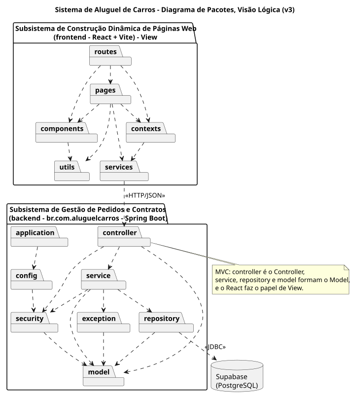
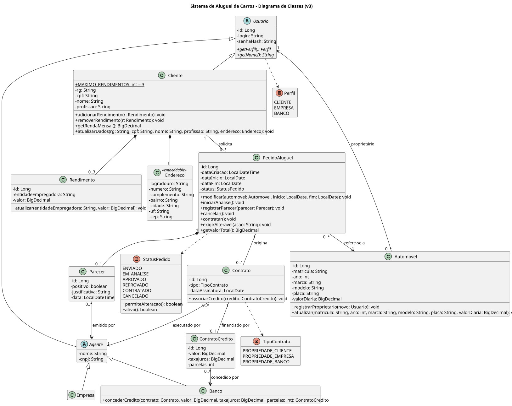

# Sistema de Aluguel de Carros

> [!NOTE]
> Sistema web para clientes pedirem o aluguel de automóveis e para agentes, empresas e bancos, avaliarem esses pedidos e executarem os contratos.

Laboratório 02 da disciplina Desenvolvimento e Integração de Aplicações Web (DIAW), com o Prof. Dr. João Paulo Carneiro Aramuni.

---

## ✅ Status do Projeto

[](https://github.com/thevictorcandido/sistema-de-aluguel-de-carro/actions/workflows/ci.yml)


Concluído. O histórico de cada etapa está nas [issues](https://github.com/thevictorcandido/sistema-de-aluguel-de-carro/issues), no [plano de construção](docs/PLANO.md) e no [relatório de verificação](docs/VERIFICACAO.md).

---

## 📚 Índice

- [Links Úteis](#-links-úteis)
- [Sobre o Projeto](#-sobre-o-projeto)
- [Funcionalidades Principais](#-funcionalidades-principais)
- [Tecnologias Utilizadas](#-tecnologias-utilizadas)
- [Arquitetura](#-arquitetura)
- [Instalação e Execução](#-instalação-e-execução)
- [Estrutura de Pastas](#-estrutura-de-pastas)
- [Testes](#-testes)
- [Documentações utilizadas](#-documentações-utilizadas)
- [Autores](#-autores)

---

## 🔗 Links Úteis

- 📐 **Modelagem UML:** [docs/uml](docs/uml/README.md), com todas as versões dos diagramas (`v1`, `v2` e `v3`).
- 📄 **Especificação técnica:** [docs/SPEC.md](docs/SPEC.md).
- 🎨 **Direção visual:** [DESIGN.md](DESIGN.md).
- 🗂️ **Plano de construção:** [docs/PLANO.md](docs/PLANO.md).
- ✅ **Relatório de verificação:** [docs/VERIFICACAO.md](docs/VERIFICACAO.md).
- 🎤 **Roteiro da apresentação:** [docs/APRESENTACAO.md](docs/APRESENTACAO.md).

O sistema roda localmente; não há demonstração online.

---

## 📝 Sobre o Projeto

O sistema permite efetuar, cancelar e modificar pedidos de aluguel de automóveis pela internet. Clientes individuais se cadastram e enviam pedidos. Agentes, que são empresas e bancos aderentes, avaliam cada pedido do ponto de vista financeiro e, com parecer positivo, executam o contrato. Um banco pode ainda associar um contrato de crédito ao aluguel.

O automóvel fica registrado como propriedade do cliente, da empresa ou do banco, conforme o tipo do contrato executado.

---

## ✨ Funcionalidades Principais

- 🔐 **Cadastro e login** de clientes e agentes, com acesso bloqueado a quem não estiver autenticado.
- 👤 **Dados do cliente:** RG, CPF, nome, endereço, profissão e até 3 rendimentos, com exclusão de conta protegida quando há pedido ativo ou contrato executado.
- 📝 **Pedidos de aluguel:** criar, consultar, modificar e cancelar, acompanhando o caminho do pedido (`Enviado → Em análise → Aprovado → Contratado`).
- 📊 **Análise financeira:** o agente consulta a fila de pedidos, vê os rendimentos do cliente e a renda comprometida (referência informativa de 30%) e registra um parecer fundamentado.
- 📑 **Contratos:** execução do contrato sobre pedido aprovado e atualização automática do proprietário do automóvel.
- 🏦 **Crédito bancário:** contrato de crédito concedido por banco agente, com valor financiado, taxa de juros e número de parcelas.
- 🚗 **Automóveis:** cadastro e manutenção por agentes, com matrícula, ano, marca, modelo, placa no padrão Mercosul e valor da diária.

---

## 🛠 Tecnologias Utilizadas

### 💻 Front-end

- **Biblioteca:** React 19
- **Linguagem:** JavaScript (ES2022+)
- **Estilização:** CSS Modules com os tokens do [DESIGN.md](DESIGN.md)
- **Rotas:** React Router
- **Ícones:** Lucide
- **Build Tool:** Vite 8
- **Qualidade e Testes:** Biome, Vitest com Testing Library e Playwright (ponta a ponta)

### 🖥️ Back-end

- **Linguagem:** Java 25 (JDK)
- **Framework:** Spring Boot 4.0.9, em arquitetura MVC
- **Banco de Dados:** Supabase (PostgreSQL); H2 em modo PostgreSQL no perfil `local`
- **ORM e migrações:** Spring Data JPA (Hibernate) e Flyway
- **Autenticação:** Spring Security com BCrypt e JWT em cookie `HttpOnly`
- **Build:** Apache Maven, pelo Maven Wrapper

### ⚙️ Infraestrutura & DevOps

- **CI:** GitHub Actions, com testes do back-end, lint, testes e build do front-end em cada PR

---

## 🏗 Arquitetura

O sistema segue o MVC com dois subsistemas, como pede o enunciado:

- **Construção dinâmica das páginas web** (`frontend/`): o React faz o papel de View e consome a API em JSON.
- **Gestão de pedidos e contratos** (`backend/`): `controller` é o Controller; `service`, `repository` e `model` formam o Model. Os pacotes seguem a organização usada na disciplina, com a classe principal em `application`, configuração de segurança em `config` e as classes de entrada e saída da API em `model`, sem pacote `dto`.

Durante o desenvolvimento, o Vite repassa as chamadas a `/api` para o Spring Boot. Front e API ficam na mesma origem, sem necessidade de CORS.

| Diagrama de Pacotes (v3) | Diagrama de Classes (v3) |
| :---: | :---: |
|  |  |

Todas as versões dos diagramas (`v1`, `v2` e `v3`), incluindo o diagrama de casos de uso e as histórias de usuário, estão em [docs/uml/README.md](docs/uml/README.md). Detalhes das camadas, rotas da API e regras de negócio em [docs/SPEC.md](docs/SPEC.md).

---

## 🔧 Instalação e Execução

### Pré-requisitos

- **Java JDK 25**
- **Node.js 24** ou superior, com npm
- Maven não precisa estar instalado: o projeto usa o Maven Wrapper (`mvnw`).

### 🔑 Variáveis de Ambiente

#### 1 Back-end (Spring Boot)

Sem nenhuma variável, a API sobe no perfil `local`, com banco H2 em memória. Para usar o Supabase, copie `backend/.env.example` para `backend/.env` e preencha:

| Variável | Descrição | Exemplo |
| :--- | :--- | :--- |
| `SPRING_PROFILES_ACTIVE` | Perfil de banco | `supabase` |
| `DB_URL` | JDBC do Session pooler do Supabase | `jdbc:postgresql://aws-0-sa-east-1.pooler.supabase.com:5432/postgres?sslmode=require` |
| `DB_USER` | Usuário do banco | `postgres.abcdefghijkl` |
| `DB_PASSWORD` | Senha do banco | — |
| `JWT_SECRET` | Chave de assinatura do token, 32 caracteres ou mais | — |

O arquivo `.env` não vai para o git.

#### 2 Front-end (React, Vite)

Não há variáveis obrigatórias: o front chama `/api`, e o Vite repassa para `http://localhost:8080`.

### 📦 Instalação de Dependências

```bash
git clone https://github.com/thevictorcandido/sistema-de-aluguel-de-carro.git
cd sistema-de-aluguel-de-carro
```

```bash
cd frontend
npm install
```

O back-end baixa as dependências na primeira execução do `mvnw`.

### 💾 Inicialização do Banco de Dados

As tabelas e os dados iniciais são criados pelo Flyway quando a API sobe, tanto no H2 quanto no Supabase, a partir de `backend/src/main/resources/db/migration`. Nenhum passo manual é necessário.

Usuários de teste criados pela migração inicial, todos com a senha `senha123` e dados fictícios:

| Login | Perfil | Nome |
| :--- | :--- | :--- |
| `marina` | Cliente | Marina Costa |
| `joao` | Cliente | João Ferreira |
| `rotasul` | Empresa | Locadora Rota Sul |
| `vialeste` | Empresa | Locadora Via Leste |
| `horizonte` | Banco | Banco Horizonte |
| `confianca` | Banco | Banco Confiança |

### ⚡ Como Executar a Aplicação

#### Terminal 1: Back-end (Spring Boot)

```bash
cd backend
./mvnw spring-boot:run
```

No Windows, use `mvnw.cmd spring-boot:run`. A API fica em **http://localhost:8080**.

#### Terminal 2: Front-end (React, Vite)

```bash
cd frontend
npm run dev
```

O front-end fica em **http://127.0.0.1:5173**. Se a porta 5173 estiver ocupada, o Vite para com um aviso em vez de subir em outra porta.

---

## 📂 Estrutura de Pastas

```text
.
├── backend/                 # API Spring Boot (Controller e Model)
│   ├── src/main/java/br/com/aluguelcarros/
│   │   ├── application/     # Classe principal
│   │   ├── config/          # Spring Security e fuso horário
│   │   ├── controller/      # Rotas REST
│   │   ├── exception/       # Erros de negócio e tratador global
│   │   ├── model/           # Entidades JPA, enums e classes de entrada e saída da API
│   │   ├── repository/      # Spring Data JPA
│   │   ├── security/        # Geração, leitura e filtro do JWT em cookie HttpOnly
│   │   └── service/         # Regras de negócio e verificação de dono
│   └── src/main/resources/  # Perfis e migrações do Flyway (V1 e V2)
├── frontend/                # React + Vite (View)
│   ├── e2e/                 # Testes ponta a ponta com Playwright
│   └── src/
│       ├── components/      # Placa, CaminhoPedido, SeloStatus, Moldura, Dialogo, Campo
│       ├── contexts/        # Sessão do usuário autenticado
│       ├── pages/           # Uma pasta por tela do DESIGN.md
│       ├── routes/          # Guarda de rotas e itens de menu por perfil
│       ├── services/        # Cliente HTTP da API
│       ├── styles/          # Tokens e estilos base
│       └── utils/           # Formatação de moeda, datas e documentos e hooks de página
├── docs/
│   ├── uml/                 # Diagramas PlantUML e SVG (v1, v2 e v3)
│   ├── APRESENTACAO.md      # Roteiro da apresentação comparando protótipo e modelos
│   ├── PLANO.md             # Plano de construção em 13 tarefas
│   ├── SPEC.md              # Especificação técnica
│   └── VERIFICACAO.md       # Relatório de verificação de código, segurança e interface
└── DESIGN.md                # Direção visual aprovada
```

---

## 🧪 Testes

### Back-end (130 testes)

```bash
cd backend
./mvnw verify
```

JUnit 5 e MockMvc, com o banco H2. Cobrem todas as transições do ciclo do pedido, o limite de 3 rendimentos, as regras de contrato e crédito, as permissões de cada perfil, o isolamento entre clientes e as migrações com os dados iniciais.

### Front-end (67 testes + lint)

```bash
cd frontend
npm test
npx biome check
```

Vitest com Testing Library, e Biome para formatação e lint.

### Ponta a ponta (6 fluxos, Chrome e Firefox)

```bash
cd frontend
npx playwright install chromium firefox
npm run e2e
```

Playwright no Chrome e no Firefox. O comando sobe uma API própria na porta 8091 (perfil `local`, H2 em memória) e um Vite na 5181, sem esbarrar nos servidores de desenvolvimento. Os testes cobrem o fluxo completo do enunciado: cadastro, login, pedido, análise, aprovação e contrato; reprovação, modificação e cancelamento; e o controle de acesso de cada perfil. A primeira linha só é necessária na primeira vez, para baixar os navegadores.

### Limitações conhecidas

Registradas em [docs/VERIFICACAO.md](docs/VERIFICACAO.md) e [docs/SPEC.md](docs/SPEC.md) por se tratar de execução local sem publicação:
- **Sessão stateless:** o logout apaga o cookie `HttpOnly`, mas um token copiado manualmente permaneceria válido até expirar (8 horas) sem uma lista de revogação no servidor.
- **Flag `Secure` no cookie:** desligada por padrão para permitir login em `http://127.0.0.1` (`app.cookie.seguro=true` deve ser ativado se publicado sob HTTPS).
- **Limite de tentativas de login:** não há rate limiting na rota de login.

---

## 🔗 Documentações utilizadas

- [Spring Boot](https://docs.spring.io/spring-boot/index.html)
- [Spring Security](https://docs.spring.io/spring-security/reference/index.html)
- [Flyway](https://documentation.red-gate.com/flyway)
- [React](https://react.dev/)
- [Vite](https://vite.dev/guide/)
- [Supabase: conexão com o banco](https://supabase.com/docs/guides/database/connecting-to-postgres)
- [PlantUML](https://plantuml.com/)

---

## 👥 Autores

| Nome | GitHub |
| :--- | :--- |
| Victor Cândido Leite | [@thevictorcandido](https://github.com/thevictorcandido) |
