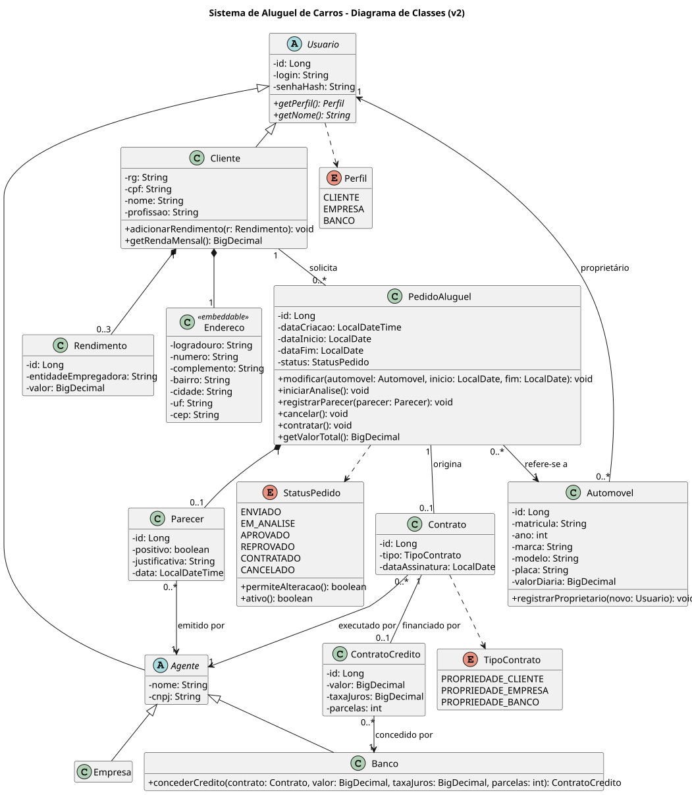
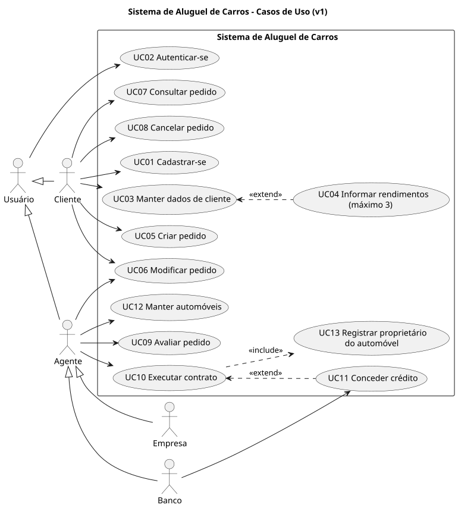
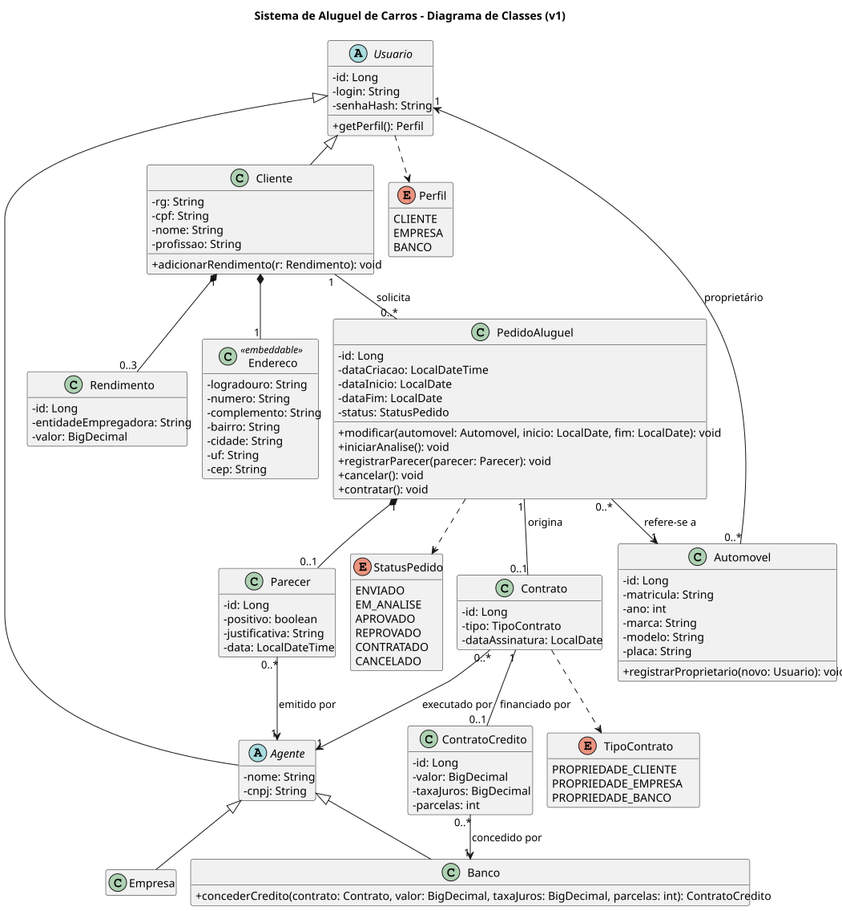
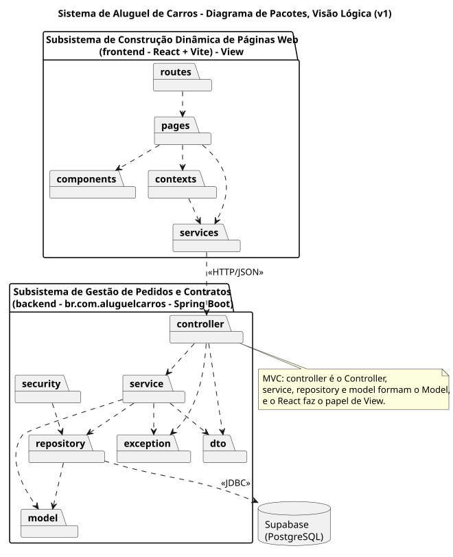

# Modelos UML

Cada revisão fica em uma pasta própria, sem sobrescrever as anteriores. Os arquivos `.puml` são a fonte em PlantUML, e os `.svg` são gerados a partir deles.

## Versões

| Versão | Data | Mudanças |
|---|---|---|
| [v1](v1) | 2026-11-02 | Modelos iniciais, a partir do enunciado |
| [v2](v2) | 2026-11-04 | Classes alinhadas ao código da tarefa 2: `valorDiaria` em `Automovel`, `getValorTotal` em `PedidoAluguel`, `getRendaMensal` em `Cliente`, `getNome` em `Usuario` e as regras de status em `StatusPedido` |

## v2

Só o diagrama de classes mudou. Casos de uso, histórias e pacotes continuam os da v1.

### Classes

## v1

- [Histórias de usuário](v1/historias-de-usuario.md)

### Casos de uso

### Classes

### Pacotes

